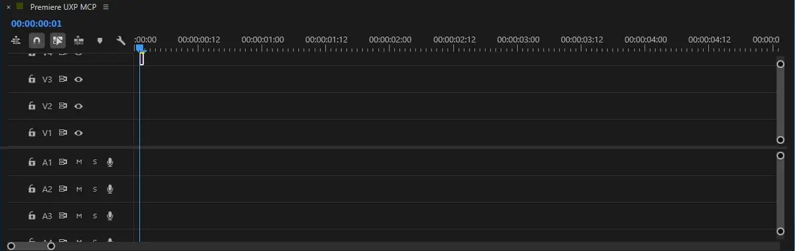
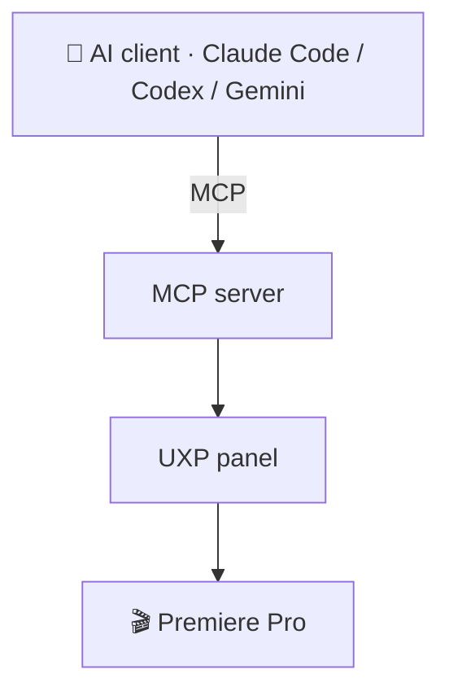

<p align="center">
  
</p>

<div align="center">

# 🎬 Premiere UXP MCP

**Edit your Premiere Pro timeline with Claude, Codex or Gemini while watching the AI agent make each change on screen.**<br>
<sub lang="ko">Claude·Codex·Gemini로 Premiere Pro 타임라인을 편집하면서, AI 에이전트가 고치는 모습을 화면에서 바로 봅니다.</sub>


<kbd>[🚀 Install](#-install-설치)</kbd> &nbsp; <kbd>[🤖 AI install](AI_INSTALL.md)</kbd> &nbsp; <kbd>[📖 Installation details](docs/installation.md)</kbd> &nbsp; <kbd>[🧭 Agent guide](docs/agent-start-here.md)</kbd>

</div>

---

## ⚖️ License <br><sub lang="ko">라이선스</sub>

If people are going to clone it anyway, we may as well open it from the start under **[0BSD](LICENSE)**.<br>
<sub lang="ko">어차피 사람들이 복제할 거라면 처음부터 열어 두는 편이 낫기에 **0BSD**로 공개합니다.</sub>

<table>
<tr>
<td width="50%" valign="top">

✅ **Free for any use**<br>
Use it for personal projects, work, or paid products and services.<br>
<sub lang="ko">개인 작업, 회사 업무, 유료 제품과 서비스 어디에든 쓸 수 있습니다.</sub>

</td>
<td width="50%" valign="top">

🆓 **No permission or fee**<br>
Copy, modify, redistribute or sell it without asking or paying.<br>
<sub lang="ko">허락을 구하거나 비용을 내지 않고 복사·수정·재배포·판매할 수 있습니다.</sub>

</td>
</tr>
<tr>
<td width="50%" valign="top">

🙏 **Credit is optional**<br>
A one-line mention of "brahmayantra1958" is always appreciated.<br>
<sub lang="ko">출처 표시는 선택입니다. "brahmayantra1958" 한 줄을 남겨 주시면 언제나 고맙습니다.</sub>

</td>
<td width="50%" valign="top">

📄 **As is**<br>
We provide it without warranty, and bundled third-party parts follow their own licenses ([notices](THIRD_PARTY_NOTICES.md)).<br>
<sub lang="ko">보증 없이 있는 그대로 제공하며, 함께 쓰는 외부 구성 요소는 각자의 라이선스를 따릅니다([고지](THIRD_PARTY_NOTICES.md)).</sub>

</td>
</tr>
</table>

## ✨ What you can do <br><sub lang="ko">할 수 있는 일</sub>

<table>
<tr>
<td width="50%" valign="top">

💬 **Edit by just asking**<br>
Ask "Cut at 3 seconds," "Close the gaps," "Warm up the color," or "Export a review copy," and the AI agent does it right away.<br>
<sub lang="ko">「3초에서 잘라 줘」「빈 곳 메워 줘」「색감 따뜻하게」「검토용으로 내보내 줘」라고 말하면 AI 에이전트가 바로 처리합니다.</sub>

</td>
<td width="50%" valign="top">

👀 **See every change as the AI makes it**<br>
The AI agent moves the playhead and selects each clip as it edits, so you see what it changed on screen.<br>
<sub lang="ko">AI 에이전트가 작업할 때마다 재생헤드를 옮기고 클립을 선택하므로, 무엇을 고쳤는지 화면에서 바로 볼 수 있습니다.</sub>

</td>
</tr>
<tr>
<td width="50%" valign="top">

🔁 **Hand off the busywork**<br>
Tell the AI agent to build captions from an SRT, add titles and transitions, or adjust color and audio across dozens of clips in one request.<br>
<sub lang="ko">SRT 자막 생성, 타이틀·전환 효과 삽입, 수십 개 클립의 색·소리 조정을 한 번의 요청으로 AI 에이전트에게 맡길 수 있습니다.</sub>

</td>
<td width="50%" valign="top">

🤝 **Stay in charge**<br>
Jump in and edit by hand anytime, and trim any cut later. The AI agent leaves your original footage as it is.<br>
<sub lang="ko">언제든 직접 이어서 편집하고, 어떤 컷이든 나중에 다시 다듬을 수 있습니다. AI 에이전트는 원본 영상을 그대로 둡니다.</sub>

</td>
</tr>
</table>

### 🧭 How it works <br><sub lang="ko">작동 방식</sub>



Your AI client edits Premiere through a local MCP server and the UXP panel.<br>
<sub lang="ko">AI 클라이언트가 로컬 MCP 서버와 UXP 패널을 거쳐 Premiere를 편집합니다.</sub>

## 🎬 See it in action <br><sub lang="ko">시연</sub>

### 🎵 Final render <br><sub lang="ko">최종 렌더</sub>

The AI agent switched 203 clips to a new font and effect every frame and laid down percussion and orchestral chords.<br>
<sub lang="ko">AI 에이전트가 클립 203개를 프레임마다 새 글꼴과 효과로 바꿨고, 타악기와 오케스트라 화음을 깔았습니다.</sub>

https://github.com/user-attachments/assets/1b96dd6e-09f3-4348-ad5c-613133889664

### 🎯 Follow demo <br><sub lang="ko">따라가기 시연</sub>

<!--
  PLACEHOLDER (demo): replace this table with a looping clip, e.g.
  
  Spec: 6–8 s, 960 px wide, 3 MB or less. Show a chat request, the playhead jumping to the target clip and Effect Controls expanding.
  For light/dark variants use <picture> with <source media="(prefers-color-scheme: dark)" srcset="...">.
  Ship every new asset through publicAssets in scripts/distribution/release-policy.mjs.
-->
<table>
<tr>
<td align="center" width="760">
<br>
🎬 <b>Demo video</b><br><sub lang="ko">시연 영상</sub><br>
<sub>Coming soon: the AI pointing at the clip it is editing.</sub><br>
<sub lang="ko">준비 중: AI가 고치는 클립을 짚어 주는 장면</sub>
<br><br>
</td>
</tr>
</table>

<!--
  PLACEHOLDER (screenshots): replace each cell with .png" width="240" alt="...">.
  Suggested files: panel.png, follow-playhead.png, effect-controls.png (16:10, same width).
-->
<table>
<tr>
<td align="center" width="250">
<br>🖼️<br><b>Panel</b><br><sub lang="ko">패널</sub><br><br>
</td>
<td align="center" width="250">
<br>🖼️<br><b>Playhead &amp; clip follow</b><br><sub lang="ko">재생헤드·클립 따라가기</sub><br><br>
</td>
<td align="center" width="250">
<br>🖼️<br><b>Effect Controls</b><br><sub lang="ko">효과 컨트롤 펼침</sub><br><br>
</td>
</tr>
</table>

## 🧰 Before you start <br><sub lang="ko">준비물</sub>

- [ ] **Windows x64** (macOS is experimental)<br>
  <sub lang="ko">Windows x64(macOS는 실험적 지원)</sub>
- [ ] **Premiere Pro 26.3 or later** with Creative Cloud<br>
  <sub lang="ko">Premiere Pro 26.3 이상과 Creative Cloud</sub>
- [ ] **Claude Code, Codex or Gemini**<br>
  <sub lang="ko">Claude Code, Codex 또는 Gemini</sub>
- [ ] **Internet access** for Setup<br>
  <sub lang="ko">Setup에 쓸 인터넷 연결</sub>

You do not need UXP Developer Tool.<br>
<sub lang="ko">UXP Developer Tool은 설치하지 않아도 됩니다.</sub>

## 🚀 Install <br><sub lang="ko">설치</sub>

> [!IMPORTANT]
> **Quit Premiere Pro before running Setup.**<br>
> <sub lang="ko">Setup을 실행하기 전에 Premiere Pro를 종료하세요.</sub>

1. **Extract** the release ZIP into a folder you will keep, so your AI client can run the MCP server from there.<br>
   <sub lang="ko">배포 ZIP을 계속 보관할 폴더에 풉니다. AI 클라이언트가 그 폴더에서 MCP 서버를 실행합니다.</sub>
2. **Run Setup** (`Setup.cmd` on Windows, `Setup.command` on macOS) and choose your AI client.<br>
   <sub lang="ko">Windows는 `Setup.cmd`, macOS는 `Setup.command`를 실행하고 AI 클라이언트를 고릅니다.</sub>
3. **Approve Adobe's install prompt,** then open your project and choose **Window → UXP Plugins → Premiere UXP MCP**.<br>
   <sub lang="ko">Adobe 설치 창을 승인한 뒤, 프로젝트를 열고 **Window → UXP Plugins → Premiere UXP MCP**를 선택합니다.</sub>
4. **Press <kbd>Enter</kbd>** in the Setup window to connect. To connect later, run `Connect.cmd` or `Connect.command`.<br>
   <sub lang="ko">Setup 창에서 <kbd>Enter</kbd>를 눌러 연결합니다. 나중에 연결하려면 `Connect.cmd`나 `Connect.command`를 실행합니다.</sub>
5. **Open a new session** in your AI client and start editing.<br>
   <sub lang="ko">AI 클라이언트에서 새 세션을 열고 편집을 시작합니다.</sub>

♊ **Using Gemini?** In Antigravity, restart `premiere` under **MCP Servers** before you open a new conversation.<br>
<sub lang="ko">Gemini를 쓴다면 새 대화를 열기 전에 Antigravity의 **MCP Servers**에서 `premiere`를 다시 시작하세요.</sub>

<!--
  PLACEHOLDER (install walkthrough): replace this table with docs/assets/install.gif (10–15 s, 960 px wide):
  the extracted folder → Setup's client prompt → Window → UXP Plugins → the connected panel.
-->
<table>
<tr>
<td align="center" width="760">
<br>
📽️ <b>Install walkthrough</b><br><sub lang="ko">설치 따라 하기</sub><br>
<sub>Coming soon: from the extracted folder to the connected panel.</sub><br>
<sub lang="ko">준비 중: 압축을 푼 폴더부터 연결된 패널까지</sub>
<br><br>
</td>
</tr>
</table>

> [!TIP]
> **Let your AI install it.** Open this folder in Claude Code, Codex or Gemini and paste:<br>
> <sub lang="ko">AI에게 설치를 맡기려면 Claude Code·Codex·Gemini 중 하나에서 이 폴더를 열고 아래 문장을 붙여 넣으세요.</sub>
>
> ```text
> Install Premiere UXP MCP by following AI_INSTALL.md in this folder.
> ```

🍎 **macOS blocked the script?** See the [run instructions](docs/installation.md#macos).<br>
<sub lang="ko">macOS가 스크립트를 막으면 [실행 안내](docs/installation.md#macos)를 보세요.</sub>

🩺 **Something went wrong?** Follow the [recovery runbook](docs/operator-runbook.md#recovery-decision).<br>
<sub lang="ko">문제가 생기면 [복구 런북](docs/operator-runbook.md#recovery-decision)을 따르세요.</sub>

---

## 📚 Reference <br><sub lang="ko">참고</sub>

<details>
<summary>🗂️ <b>Support matrix:</b> Windows full, macOS experimental<br><sub lang="ko">지원 범위: Windows 전체, macOS 실험적</sub></summary>

| Feature<br><sub lang="ko">기능</sub> | Windows | macOS |
| --- | :---: | :---: |
| Timeline, clip and media editing<br><sub lang="ko">타임라인·클립·미디어 편집</sub> | ✅ | 🧪 |
| Showing the edit on screen<br><sub lang="ko">화면에 편집 위치 표시</sub> | ✅ | 🧪 |
| Track locks<br><sub lang="ko">트랙 잠금</sub> | ✅ | 🧪 |
| Track targeting, item selection, effect disclosure, SRT captions<br><sub lang="ko">트랙 타기팅·항목 선택·효과 펼침·SRT 자막</sub> | ✅ | — |
| Panel focus, effect scrolling<br><sub lang="ko">패널 포커스·효과 스크롤</sub> | ✅ | — |
| Object Mask tracking, native tools<br><sub lang="ko">Object Mask 추적·네이티브 도구</sub> | SDK plugin<br><sub lang="ko">SDK 플러그인 필요</sub> | — |
| Analysis, proxies, conversion<br><sub lang="ko">분석·프록시·변환</sub> | FFmpeg<br><sub lang="ko">FFmpeg 필요</sub> | FFmpeg<br><sub lang="ko">FFmpeg 필요</sub> |

✅ supported · 🧪 experimental · — not available · [details](docs/release-status.md)<br>
<sub lang="ko">✅ 지원 · 🧪 실험적 · — 미지원 · [자세히](docs/release-status.md)</sub>

</details>

<details>
<summary>📁 <b>Your media:</b> use any folder; the AI agent leaves originals as they are<br><sub lang="ko">내 미디어: 어느 폴더든 쓰고, AI 에이전트는 원본을 그대로 둡니다</sub></summary>

- **Use any folder.** Give the AI agent the full path to a WAV, MP4, SRT or other supported file on a local drive or NAS.<br>
  <sub lang="ko">어느 폴더든 쓸 수 있습니다. 로컬 드라이브나 NAS에 있는 WAV·MP4·SRT 등 지원 파일의 전체 경로를 AI 에이전트에게 알려 주세요.</sub>
- **The AI agent leaves your originals untouched** and saves exports, proxies and temporary files in this folder.<br>
  <sub lang="ko">AI 에이전트는 원본 파일을 바꾸지 않고, 내보낸 파일·프록시·임시 파일을 이 폴더에 저장합니다.</sub>
- **On macOS,** keep the project file on your internal drive.<br>
  <sub lang="ko">macOS에서는 프로젝트 파일을 내장 드라이브에 두세요.</sub>

</details>

<details>
<summary>🛠️ <b>Development</b><br><sub lang="ko">개발</sub></summary>

Run these commands with Node 24:<br>
<sub lang="ko">Node 24에서 아래 명령을 실행합니다.</sub>

```sh
npm ci
npm run check
npm run package:release
```

- `npm run check` runs lint, type checks, tests and the build.<br>
  <sub lang="ko">`npm run check`는 lint, 타입 검사, 테스트, 빌드를 실행합니다.</sub>
- `npm run package:release` builds the release ZIP.<br>
  <sub lang="ko">`npm run package:release`는 배포 ZIP을 만듭니다.</sub>
- To test panel changes, load the built manifest with [UDT developer loading](docs/installation.md#developer-loading).<br>
  <sub lang="ko">패널 수정을 시험하려면 [UDT 개발 로드](docs/installation.md#developer-loading)로 빌드된 manifest를 불러옵니다.</sub>
- More: [installation](docs/installation.md), [operating contract](docs/agent-contract.md), [bundled skills](skills/README.md), [feature status](docs/release-status.md).<br>
  <sub lang="ko">더 보기: [설치](docs/installation.md), [운영 계약](docs/agent-contract.md), [동봉 스킬](skills/README.md), [기능별 상태](docs/release-status.md)</sub>

</details>

<div align="right">

<sub>[↑ Back to top](#-premiere-uxp-mcp)</sub>

</div>
